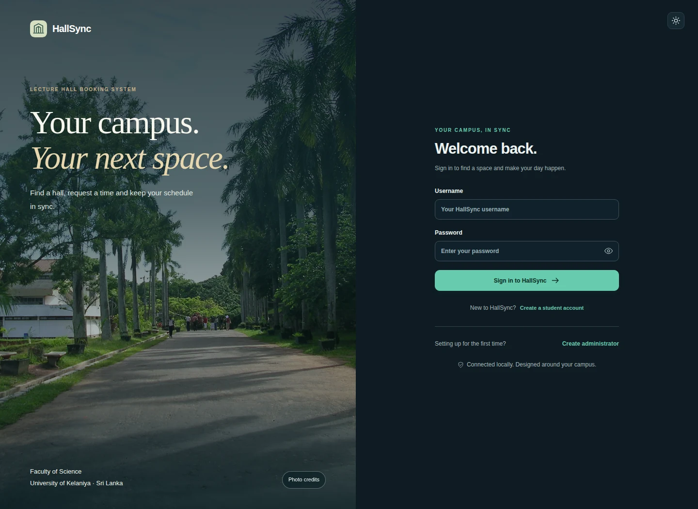

# HallSync · University of Kelaniya

Lecture hall booking and campus space management with a **Java OOP backend, HTML/CSS/JavaScript interface and MySQL 8.0.46**.



## Start or update

Requirements: JDK 17 or later, Maven, MySQL 8.0.46 and MySQL Workbench. Java 21 and 26 are checked in CI. Node.js, Python, XAMPP and a separate web server are not needed to run the downloaded project.

1. Download the repository ZIP and **Extract All** into a new folder. Close an older running HallSync first. For an existing database, make a Workbench data export before upgrading.
2. In your usual MySQL administrator connection, open **`database/HallSync_Setup.sql`**. Enable **Stop Script Execution On Errors**, then execute the entire file with **Ctrl + Shift + Enter**. This is the only setup file for fresh and existing HallSync installations. Existing accounts, password hashes, department IDs, bookings and decisions are retained. Do not drop the database.
3. For a newly created `hallsync_app` connection account, Workbench returns its **generated password**. Keep it private. An existing account keeps its password. If you retained your old `application/db.local.properties`, copy it into the new `application` folder; otherwise use the connection form in the next step.
4. Double-click **`run_hallsync.cmd`**. The console stays open and shows build/startup errors. The first Maven build needs internet access. When the browser opens, enter:

   | Connection field | Value |
   | --- | --- |
   | Database address | `jdbc:mysql://127.0.0.1:3306/hallsync_db` |
   | Connection username | `hallsync_app` |
   | Connection password | Your private MySQL connection password |

   Click **Test & connect**. HallSync creates `application/db.local.properties` automatically. Keep the console open while using HallSync.
5. Sign in using your existing HallSync administrator account. On a fresh installation, expand **Local installation setup → Create administrator** on the sign-in page. Use your local MySQL administrator credentials once to provision your own application administrator. These are separate from the `hallsync_app` connection credentials and are not saved by the initialization form.
6. Open **Campus manager** to add your actual course units and student groups for Lecture/Tutorial requests. Published-capacity halls are already Active. Enter existing university timetable reservations as bookings before relying on availability. Confirm current seating, equipment and room access locally before a real campus deployment.

If you lost only the connection password, run the following once in Workbench as your MySQL administrator, then enter the returned generated password in the connection form:

```sql
ALTER USER 'hallsync_app'@'127.0.0.1'
IDENTIFIED BY RANDOM PASSWORD;
```

This does not reset HallSync application sign-in passwords. Never upload the generated password or `db.local.properties` to GitHub.

If the browser does not open, use the exact address printed in the console. The usual address is `http://127.0.0.1:8080`; a free port is chosen if it is busy. If double-clicking fails, open Command Prompt in the extracted root folder and run `run_hallsync.cmd --console`.

## Three roles

| Role | Registration and approval | Main actions |
| --- | --- | --- |
| Student | Public registration → inactive → administrator verifies university identity → approved | View active halls and published schedules, filter courses, export calendar, submit and track own room reports |
| Lecturer | Public registration with staff ID → inactive → administrator verifies identity → approved | Student viewing actions plus request halls, manage own Pending requests, cancel own reservations, view own agenda/calendar |
| Administrator | Local privileged initialization or provisioning by an existing administrator | Manage halls and access, approve registrations and bookings, maintain equipment, create closures, resolve room reports, view dated reports and exports |

Registration and booking approval are separate. Public signup cannot create an administrator. A matching name, staff ID or email is not proof of ownership: the administrator checks university records and confirms the registration through an independent university channel. This is manual verification, not university single sign-on or automatic email verification. Reviewers never receive passwords. Passwords use salted Argon2id hashes and require 8–128 characters.

Existing administrator-provisioned users remain valid. New student and lecturer self-registrations require approval. Rejection requires a reason and keeps the account inactive. A decision and account activation commit together, with reviewer, time and note retained. Rejected applications cannot be replayed into Approved. Contact the administrator for corrections; public password recovery and resubmission are outside this release.

Administrators can change other accounts' roles or active state in **People → Manage**. They cannot change their own access, activate an unverified applicant through that shortcut, or remove the final active administrator. Server requests recheck the current role and active state, so old session privileges do not survive a role change.

## Request a hall as a lecturer

1. Choose **Register as a lecturer** and submit your name, email, username, department, staff ID and password. Wait for approval in **Account approvals**.
2. Sign in and open **Find a hall**. Choose a future date, start/end time and attendance. Filter by building, faculty or working equipment. Published capacities are included; equipment filters use locally recorded working quantities.
3. Select **View space → Book this space**. Complete your purpose and session type. Lectures and tutorials require a course unit and at least one student group; an administrator adds these through Campus manager.
4. Review and send the request. It starts **Pending** and reserves no room. A different administrator approves it through **Booking approvals** after the database rechecks capacity, conflicts and closures.
5. View progress in **My bookings**. Only Pending requests can be edited. To move an Approved session, cancel it and create a new request.

Students have no booking or administration controls. Their timetable is the published campus schedule with a course filter; it does not claim to know enrollment. Lecturers can switch to **My approved bookings** and export an ICS calendar. Import the downloaded ICS into Google Calendar, Outlook or another calendar application; it is a snapshot, not a live synchronization feed. **Course materials** links to the university learning portal.

## Campus data and sources

The university directory includes seven faculty references and 57 department names. Faculty names identify directory entries and locations; the application's institutional brand is **University of Kelaniya** throughout.

The setup seeds **14 Active teaching rooms with published capacities**, including all three listed F4 rooms (201: 350; 102: 100; 101: 80 seats) and selected K14, K1, K2, K27 and K28 rooms. Capacities come from the [official university classroom directory](https://cbs.kln.ac.lk/classrooms), checked on 12 November 2026. The directory is a published reference, not a live reservation feed or a guarantee of current seating. Existing matching halls are never overwritten or automatically reactivated by a repeat setup/import.

A8 Auditorium's **sixth-floor** location is sourced from the [university's 2023 SDG archive](https://sdgpt.kln.ac.lk/archives/2023). Its capacity remains unconfirmed, so it is a setup suggestion rather than an automatically bookable hall. Room codes such as `201` do not prove a floor level. Other unpublished floors remain empty; administrators can enter confirmed values in **Campus manager → Lecture halls → Manage**.

The equipment type catalogue includes projection, audio and connectivity, supported by the [university's teaching-facility description](https://fct.kln.ac.lk/facility/lecture-rooms). Per-room equipment counts and working quantities are not published there, so they are entered after local inspection. HallSync does not fabricate smart boards, AC units or working inventories. **Hall care** manages quantities; **Room reports** lets students and lecturers flag discrepancies and administrators record resolutions.

Source URLs and reference dates are included in `application/src/main/resources/campus.json` and linked from hall details. Campus photography is bundled locally and credited in [PHOTO_CREDITS.md](PHOTO_CREDITS.md). It depicts campus buildings and grounds, not the interior of every listed room.

## Booking integrity

- Times use Asia/Colombo. Start must be before end, the start must be in the future, purpose must be nonblank and attendance must be a positive integer within capacity.
- **Active** describes an operational hall. **Available for your time** is calculated for the chosen interval; a booking never permanently switches a hall's operational state.
- Overlap uses `existing_start < requested_end AND existing_end > requested_start`. Adjacent sessions are allowed. Pending requests may compete; only one conflicting request can be approved.
- Approval and maintenance use the same hall-row lock and coordinated transaction. Two simultaneous administrators cannot approve conflicting reservations. A closure cannot silently displace an approved booking.
- The requester comes from the authenticated session and owns the booking. An administrator cannot approve their own hall request.
- Cancelled, Rejected and Completed bookings remain terminal and are retained with history. Completed is allowed only after an Approved session ends.
- Hall edits cannot invalidate future approved reservations. Retiring a hall with history makes it Inactive; an unused hall can be removed. Quantity must be positive and `0 <= WorkingQuantity <= Quantity`.
- Students and lecturers see only their own discrepancy reports; administrators see the queue. Resolution requires an administrator and a note.

## Reports and operation

**Reports** includes inclusive date-range filtering (up to 367 days), booking status distribution, scheduled hall hours, detailed tables and CSV download. **Print / PDF** opens the browser print dialog; choose **Save as PDF**. Equipment inventory is current and is explicitly labelled independently of the booking date filter. Scheduled hours measure reservation duration, not actual room occupancy.

The main discovery/overview/approval screens refresh every minute while visible and idle. Submission and approval always validate against the current database. A manual Refresh action is available. Automatic report delivery, recurring bookings, automatic timetable generation, enrollment tracking and assignment management are excluded to keep this a focused booking system. Reports are exported on demand; no email is sent automatically.

Local operation is the default: Java binds to loopback, and browsers never connect directly to MySQL. The backend login uses a limited database role and TLS. Browser mutations require same-origin JSON and a CSRF token; sessions use HttpOnly/SameSite cookies, and authentication attempts are rate limited. The application is a university project suitable for local demonstrations; a real university launch still requires approved identity integration, a confirmed inventory/timetable, HTTPS hosting, operational backups and an institution-led security review.

## Code layout and verification

| Location | Purpose |
| --- | --- |
| `database/HallSync_Setup.sql` | Single repeatable schema, upgrades, procedures, UOK seed and connection-login setup |
| `application/src/main/java/lk/ac/kln/hallsync/model` | Domain records and status/type enums |
| `application/src/main/java/lk/ac/kln/hallsync/auth` | Password hashing, authentication and privileged initialization |
| `application/src/main/java/lk/ac/kln/hallsync/service` | Role rules, validation, booking, reports, calendar and room-report operations |
| `application/src/main/java/lk/ac/kln/hallsync/repository` | Repository interfaces and JDBC implementations with bound parameters |
| `application/src/main/java/lk/ac/kln/hallsync/web` | HTTP adapters, sessions, static assets and campus reference import |
| `application/src/main/resources/web` | Responsive UI, light/dark themes and locally bundled assets |
| `application/src/test` and `application/tests` | Java/JDBC/API and real-browser checks on disposable schemas |
| `database/tests` | Constraints, privilege boundaries, transactions and concurrent approval checks |

MySQL is the supported database. Existing normalized names are retained: `USER_ACCOUNT`, `DEPARTMENT`, `BUILDING`, `LECTURE_HALL`, `FACILITY`, `HALL_FACILITY`, `COURSE_UNIT`, `STUDENT_GROUP`, `BOOKING`, `BOOKING_GROUP`, `HALL_BLOCK`, `ACCOUNT_APPLICATION` and `ROOM_ISSUE`. The older lecturer application table is renamed safely during upgrade. A shared booking/timetable model avoids storing the same reservation in two conflicting `bookings` and `schedules` tables. The database has 13 tables, 80 columns, 19 foreign keys, 35 CHECK constraints, four reporting views and 37 procedures.

VS Code: open the extracted root and select **HallSync: Browser application**. NetBeans: open the `application` Maven project. To build and run manually:

```cmd
cd application
mvn clean package
java -jar target/hallsync.jar
```

GitHub Actions checks Java 21/26 with MySQL 8.0.46, including fresh/repeated setup, upgrading the older account table, data/password preservation, three-role registration and booking flows, unauthorized requests, session role changes, calendar/CSV export, room reports, hall retirement, mobile layout, long identities and competing approvals. Tests use isolated generated schema names and synthetic accounts, never a laptop's `hallsync_db`.

## Release validation

HallSync 3.0 passed 128 database checks and 305 application checks on each of Java 21 and Java 26 against MySQL 8.0.46. The latter include 119 API checks and 46 real-browser checks. A separate Windows job builds and launches the extracted project from a path with spaces and checks the fresh connection page. Normal-install checks confirm 14 published-capacity active halls with no demo users, invented bookings or assumed equipment quantities.

[View the report interface](.github/assets/hallsync-reports.webp). Interface previews use isolated test data.
